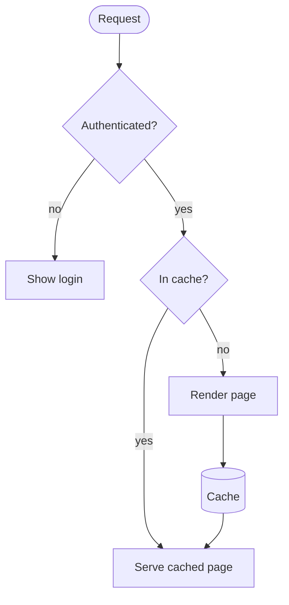
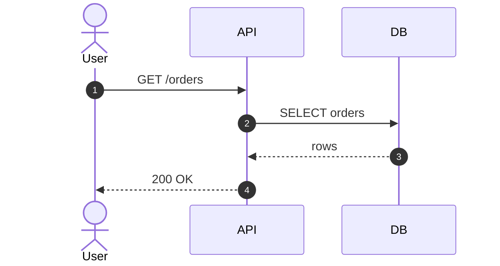
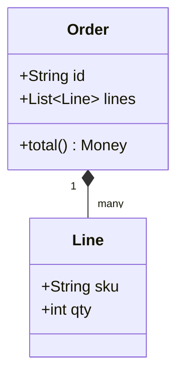
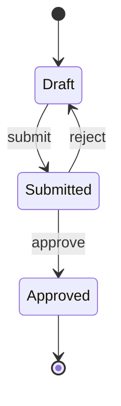
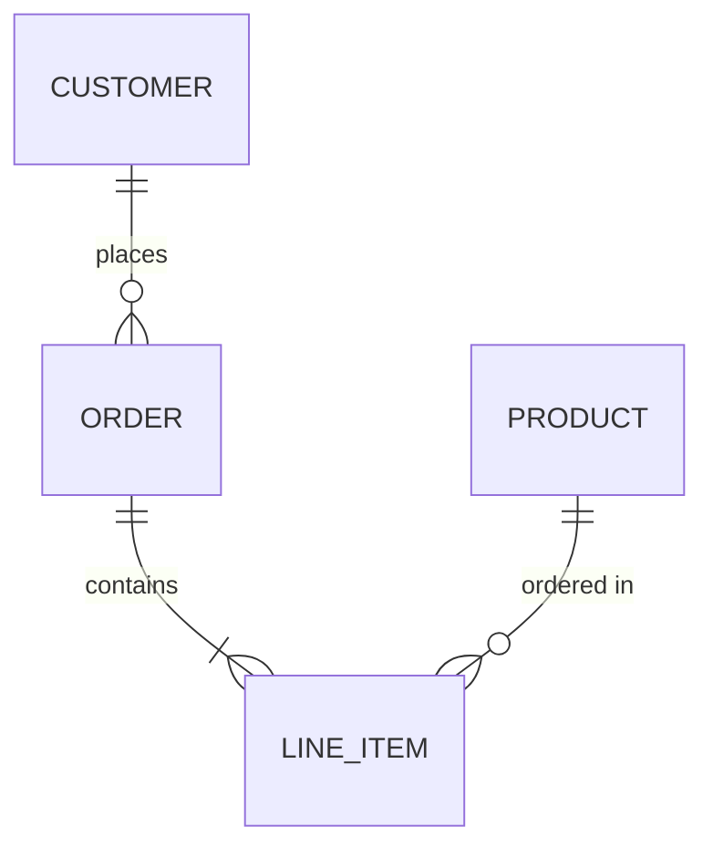
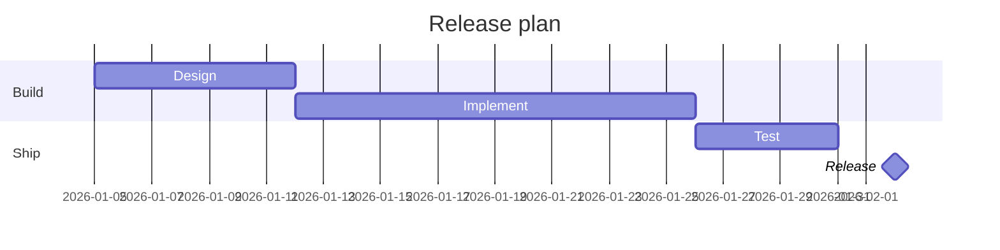
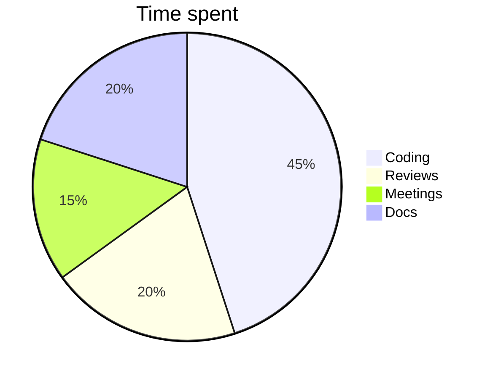
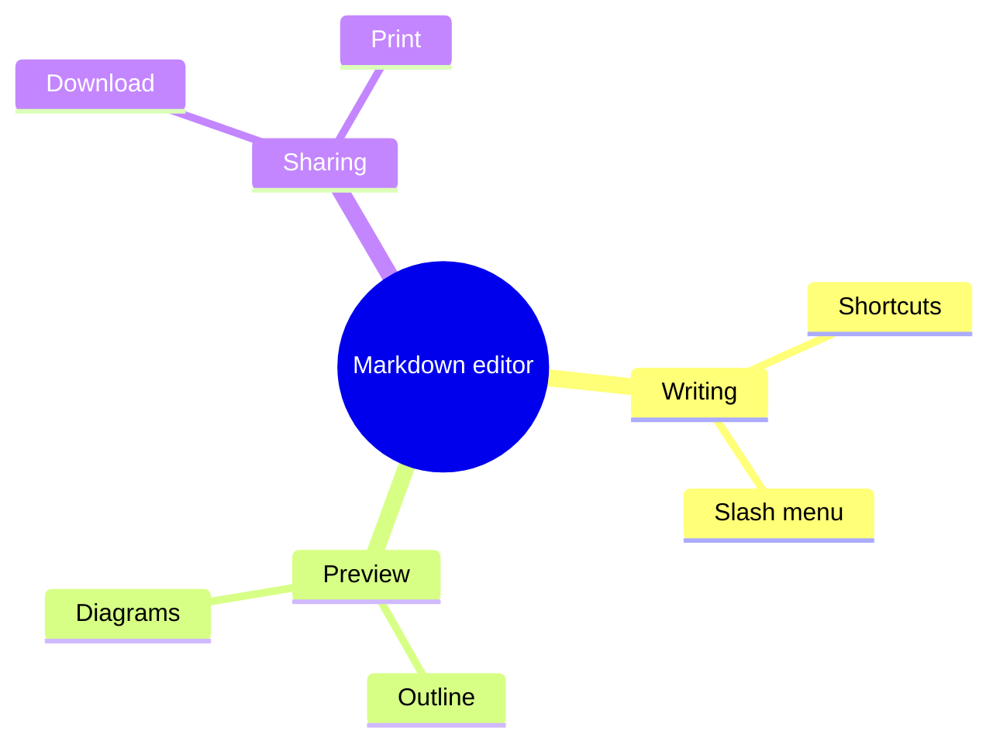

# Mermaid diagram gallery

One example of each common diagram type. Open **View** on any diagram to change its layout engine, direction, look or theme.

## Flowchart

## Sequence

## Class

## State

## Entity relationship

## Gantt

## Pie

## Mindmap

