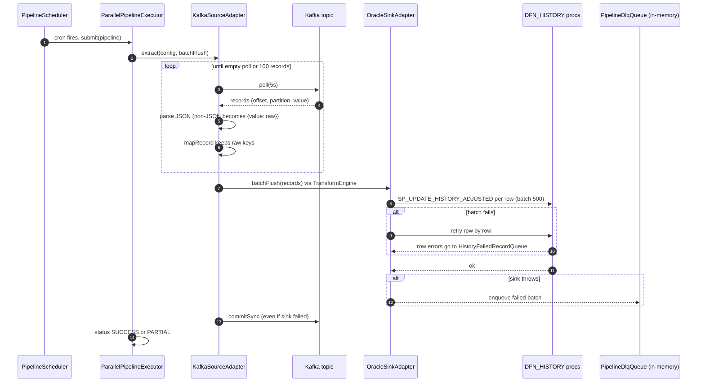

# Data Extractor: OHLC History Architecture

Diagrams for the one-day OHLC history path: TwelveData producer, Kafka topic, pipeline consumer, listener consumer and failure handling.

Topic: `data-extractor.uat.one-day-ohlc`
Oracle target: `DFN_HISTORY` (`SP_UPDATE_HISTORY_ADJUSTED`, `SP_UPDATE_HISTORY_RAW`)

## Component view

```mermaid
flowchart LR
    subgraph Control["Control plane"]
        REST["PipelineController<br/>/api/v1/pipelines"] --> PS["PipelineService"]
        CRON["PipelineScheduler<br/>cron per pipeline"] --> EX
        PS --> CRON
        CFG[("extractor-pipelines.yml<br/>+ application.yml")] -.-> CRON
    end

    subgraph Producer["Producer: twelvedata-intl-history-extractor (Instance A)"]
        TD["TwelveData REST API"] --> TDA["TwelveDataSourceAdapter<br/>retry + circuit breaker"]
        TDA --> TE1["TransformEngine"]
        TE1 --> KS1["KafkaSinkAdapter<br/>key = TICKER_ID"]
        TE1 --> OS1["OracleSinkAdapter<br/>PROCEDURE"]
    end

    subgraph Engine["Execution engine"]
        EX["ParallelPipelineExecutor<br/>in-flight guard, timeout, retry"]
        POOL["AdapterPoolRegistry"]
        EX --> POOL
        EX -->|"pipeline fails or zero records"| PRS["PipelineRetryService<br/>DB: PIPELINE_RETRY_RECORDS"]
    end

    KS1 -->|"publish JSON"| TOPIC[("Kafka topic<br/>data-extractor.uat.one-day-ohlc")]

    subgraph Consumer["Consumer: twelvedata-intl-history-consumer (Instance B)"]
        KSA["KafkaSourceAdapter<br/>poll max 100, JSON parse"]
        MAP["mapRecord<br/>no field mapping: raw keys kept"]
        TE2["TransformEngine<br/>none configured"]
        OS2["OracleSinkAdapter<br/>PROCEDURE mode"]
        KSA --> MAP --> TE2 --> OS2
    end

    TOPIC -->|"poll"| KSA
    KSA -.->|"commitSync after sink step"| TOPIC
    POOL --> KSA

    subgraph Listener["HistoryKafkaConsumerService (Spring listener, same group id)"]
        HKC["@KafkaListener<br/>manual ack"]
        HPE["HistoryProcedureExecutor<br/>named binds P_*"]
        HKC --> HPE
    end

    TOPIC -->|"HISTORY_KAFKA_CONSUMER_ENABLED"| HKC
    HKC -.->|"ack only if both procs succeed"| TOPIC

    subgraph Failures["Failure handling"]
        HFQ["HistoryFailedRecordQueue<br/>in-memory, per-row failures"]
        DLQ1["PipelineDlqQueue<br/>in-memory tier 1"]
        DLQS["PipelineDlqRetryScheduler"]
        DLQ2[("DLQ_PIPELINE_RECORDS<br/>tier 2, DB")]
        DLQ1 --> DLQS
        DLQS -->|"after max in-memory attempts"| DLQ2
    end

    OS2 -->|"row failure"| HFQ
    OS2 -->|"sink failure"| DLQ1
    OS1 -->|"sink failure"| DLQ1

    subgraph OracleHistory["Oracle: DFN_HISTORY (oracle-history datasource)"]
        SPA["SP_UPDATE_HISTORY_ADJUSTED"]
        SPR["SP_UPDATE_HISTORY_RAW"]
    end

    OS1 --> SPA
    OS1 --> SPR
    OS2 --> SPA
    OS2 --> SPR
    HPE --> SPA
    HPE --> SPR

    HSP["HistoryStalenessPostProcessor<br/>producer only, history-staleness-check"] -.-> EX
```

## Poll cycle sequence (pipeline consumer)

## Notes

- **Offsets are committed even when the sink fails.** The failed batch goes to the in-memory DLQ, so a restart loses it.
- **The listener path is dashed.** `HistoryKafkaConsumerService` is enabled by the same variable as the pipeline consumer (`HISTORY_KAFKA_CONSUMER_ENABLED`) and shares its group id.
- **The DB persist toggle does not apply to history sinks.** Their `persist: true` is hardcoded in `config/extractor-pipelines.yml`, so `HISTORY_ORACLE_PERSIST` has no effect.
- **Unverified.** `TwelveDataSourceAdapter`, the DLQ tier-2 promotion schedule and the procedure definitions were taken from class names and the README, not read directly.
