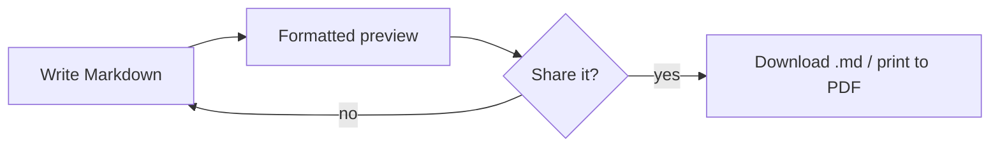
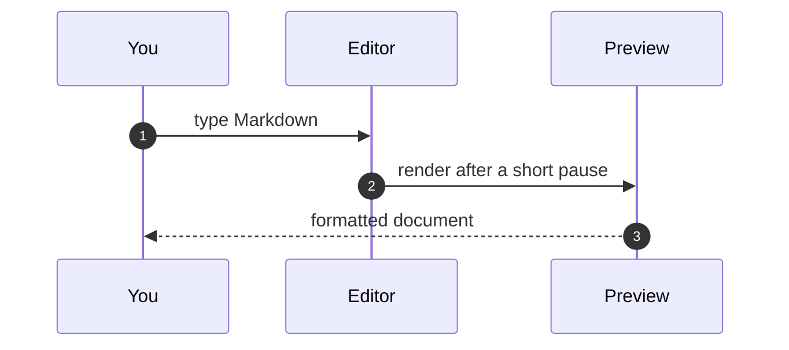

# Welcome to the Markdown editor

Write on the left, see the formatted document on the right. Everything stays **in your browser**: nothing is uploaded, and your draft is saved automatically in this browser.

> [!TIP]
> Type `/` at the start of a line for tables, code blocks, callouts and diagrams. Press `Ctrl+B`, `Ctrl+I` or `Ctrl+K` for bold, italic and links.

## Start here

- [x] Open this editor
- [ ] Rename the document: click its name in the bar above
- [ ] Open your own file with **Open…**, or drop a `.md` file anywhere on the page
- [ ] Try the **Samples** menu for a real architecture document

## Formatting

You can write *italic*, **bold**, ~~strikethrough~~, `inline code` and [links](https://www.markdownguide.org/basic-syntax/). Headings appear in the **Outline** on the left, and every section can be folded with the ▾ next to its heading.

| Shortcut | Does |
| --- | --- |
| `Ctrl+B` / `Ctrl+I` | Bold / italic |
| `Ctrl+K` | Insert a link |
| `Ctrl+Alt+1…3` | Heading 1–3 |
| `Ctrl+Alt+T` | Line up the table under the cursor |
| `Ctrl+F` | Find and replace |

> [!NOTE]
> Lists continue when you press Enter, and an empty item ends the list.

## Code

```java
public record Candle(String ticker, double open, double high, double low, double close) {
    public boolean isGreen() {
        return close >= open;
    }
}
```

## Diagrams

Fenced `mermaid` blocks become diagrams. Click a node to trace what feeds it and what it feeds; use **View** for layout, direction and themes.





> [!WARNING]
> Your draft lives in this browser only. Use **Save .md** to keep a copy.
